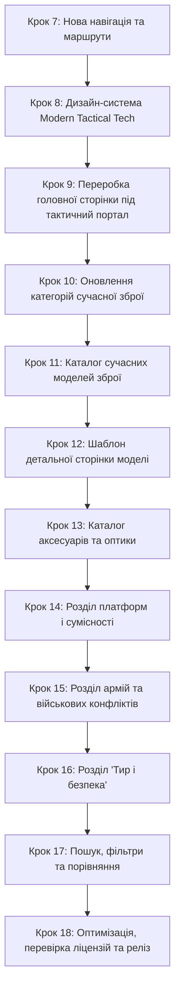

# Firearms Explorer — повний план розробки сучасного збройового порталу

> **Тип:** продуктова концепція, інформаційна архітектура, технічне завдання, контентна стратегія та roadmap розробки.  
> **Версія:** 3.0 — Modern Tactical Tech / Arms, Gear & Military Portal.  
> **Дата оновлення:** 17 жовтня 2026 року.  
> **Мова релізу:** українська.  
> **Формат:** високопродуктивний, адаптивний вебпортал, оптимізований для дослідження сучасної стрілецької зброї, обвісу, оптики та військового оснащення.  
> **Робоча назва:** Firearms Explorer.  
> **Статус:** затверджена стратегічна концепція розробки.

---

## 1. Головне рішення: новий продуктовий фокус

**Firearms Explorer — сучасний українськомовний інформаційно-освітній портал про стрілецьку зброю, аксесуари, технології та військове оснащення.**

Попередній напрям виключно історичної музейної енциклопедії скасовано. Проєкт переорієнтовано на **сучасні збройові системи XXI століття**, платформи, їх модифікації, прицільні комплекси, тактичне спорядження та документально зафіксовану практику використання у провідних арміях світу.

### 1.1. Ключові акценти
1. **Сучасні платформи та моделі:** детальний аналіз систем на базі AR-15 / M4 / AR-10, пістолетів Glock (Gen3–Gen5), гвинтівок HK416/HK417, FN SCAR, лінійок SIG Sauer (MCX, MPX, P320, Spear / NGSW), CZ, Beretta, Barrett тощо.
2. **Аксесуари та оптика:** приціли (коліматорні, голографічні, LPVO, оптичні, тепловізійні), лазерні цілевказівники, тактичні ліхтарі, цівки, дульні пристрої, глушники, приклади, сошки та магазини.
3. **Сумісність та стандарти кріплень:** вичерпні дані щодо сумісності платформ, інтерфейсів монтажу (MIL-STD-1913 Picatinny, M-LOK, KeyMod, стандарти optic footprints RMR, Docter, Acro, Aimpoint Micro, RMSc).
4. **Сучасні армії та конфлікти:** штатна стрілецька зброя підрозділів Збройних Сил України, армії США, Армії оборони Ізраїлю (ЦАХАЛ) та країн НАТО; документально зафіксоване використання в сучасних війнах, відкриті дані та аналітика.
5. **Культура стрільби, тир і безпека:** 4 правила безпеки, вибір засобів індивідуального захисту (активні навушники, балістичні окуляри), підготовка до першого тренування в тирі, робота з кваліфікованими інструкторами та правова обізнаність.

### 1.2. Роль історії в новій концепції
Історичний контекст **не є самоціллю** і виключає великі хронологічні екскурси про кремнієві замки чи рушниці XIX століття. Історичні факти подаються **всередині статей** виключно для пояснення того, чому з'явилася та чи інша сучасна система, як змінювалися військові доктрини та які інженерні проблеми вирішувалися (наприклад, перехід армії США з M16 на M4, а згодом на систему SIG XM7).

### 1.3. Редакційні межі та безпека
- **Інформаційно-довідковий характер:** сайт є технічним та військово-освітнім ресурсом, **не магазином** і не торговим майданчиком.
- **Жодних небезпечних інструкцій:** сайт категорично не публікує матеріалів із кустарного виготовлення зброї, переробки на автоматичний вогонь (full-auto conversions), несанкціонованої модифікації боєприпасів, обходу законодавчих обмежень або тактики насильства.
- **Захист чутливої інформації:** матеріали про сучасні військові формування та застосування зброї базуються виключно на публічних, відкритих і перевірених джерелах (OSINT, офіційні звіти міністерств оборони, патенти виробників, фахові мілітарні видання) без розголошення секретних тактичних операцій або позицій діючих військ.

---

## 2. Аудиторія та користувацькі сценарії

| Сегмент аудиторії | Потреба | Як допомагає Firearms Explorer |
|---|---|---|
| **Військовослужбовці та тероборона** | Розуміння особливостей штатної зброї, вибір якісного обвісу, догляд за системами | Детальні специфікації моделей, таблиці сумісності M-LOK/Picatinny, рекомендації щодо чищення та оптики |
| **Стрільці-спортсмени та власники зброї** | Підбір аксесуарів, сумісність прицілів та кріплень, вибір патронів | Паспорти аксесуарів, optic footprints, стандарти посадкових місць |
| **Початківці в культурі стрільби** | Безпечне поводження, перший візит до тиру, правовий лікнеп | Розділ «Тир і безпека», інструкції з вибору захисту очей/вух, правова методологія |
| **Мілітарні ентузіасти й аналітики** | Структуровані дані про озброєння армій, модифікації, досвід війни | Розділ «Армії та конфлікти», перевірені першоджерела, атрибутовані факти |

### Головні сценарії взаємодії:
1. **Підбір та перевірка сумісності:** знайти платформу (наприклад, AR-15) → переглянути сумісні інтерфейси цівки → дізнатися, чи встане конкретний коліматор через посадковий стандарт (footprint).
2. **Огляд моделі зброї:** відкрити модель (наприклад, Glock 19 Gen5) → вивчити відмінності покоління, ТТХ, калібр, заводські органи керування, використовувані арміями підрозділи.
3. **Дослідження військового спорядження:** відкрити підрозділ (наприклад, ССО ЗСУ або SOCOM США) → переглянути задокументовані штатні стрілецькі комплекси та обвіс.
4. **Підготовка до стрільби в тирі:** відкрити правила безпеки → дізнатися про захисні стандарти ANSI Z87.1 / MIL-PRF-32432 для окулярів та NRR для навушників → базовий чеклист початківця.

---

## 3. Нова структура сайту (п'ять розділів)

```text
/
├── /encyclopedia/             # РОЗДІЛ 1: Зброя (каталог сучасних моделей)
│   ├── [model-slug]/          # Сторінка моделі (наприклад, glock-19, hk416)
│   └── compare/               # Порівняння ТТХ моделей
├── /accessories/              # РОЗДІЛ 2: Аксесуари та оптика
│   ├── [category-slug]/       # Оптика, ліхтарі, магазини, глушники тощо
│   └── [accessory-slug]/      # Паспорт конкретного аксесуара
├── /platforms/                # РОЗДІЛ 3: Платформи та сумісність
│   ├── [platform-slug]/       # Платформа (AR-15, Glock, AK, SIG P320)
│   └── standards/             # Гайди стандартів (M-LOK, Picatinny, Footprints)
├── /military/                 # РОЗДІЛ 4: Армії та конфлікти
│   ├── armies/                # Збройні сили України, США, Ізраїлю та ін.
│   └── conflicts/             # Документальні хроніки застосування
└── /safety/                   # РОЗДІЛ 5: Тир і безпека
    ├── rules/                 # Фундаментальні правила безпеки поводження
    ├── gear/                  # Балістичний та акустичний захист
    ├── shooting-range/        # Підготовка до тиру, інструктаж
    └── law/                   # Правова методологія та офіційні джерела
```

### 3.1. Зброя (каталог) — `/encyclopedia/`
*Зберігається стабільний URL `/encyclopedia/` як центральна база моделей для збереження структури релізу.*
- Каталог сучасних серійних зразків: пістолети, карабіни/штурмові гвинтівки, високоточні/снайперські гвинтівки, дробовики, пістолети-кулемети, кулемети.
- Покоління, роки прийняття, модифікації, технічні паспорти, ергономіка, патрони.
- Інструмент порівняння двох зразків за уніфікованими ТТХ.

### 3.2. Аксесуари та оптика — `/accessories/`
- **Оптичні прилади:** коліматори відкритого/закритого типу, голографічні приціли (EOTech), приціли змінної кратності (LPVO 1-6x/1-8x), далекобійна оптика, магніфери.
- **Освітлення та цілевказання:** підствольні тактичні ліхтарі, лазерні модулі видимого та ІЧ-діапазону (AN/PEQ, DBAL, Steiner).
- **Збройова фурнітура:** цівки, приклади, пістолетні руків'я, руків'я перенесення вогню, сошки, ремені (1- та 2-точкові, QD-антабки).
- **Магазини та живлення:** стандарти STANAG, полімерні магазини (Magpul PMAG, Lancer), барабанні магазини, збільшені п'ятки.
- **Дульні пристрої:** глушники / саундмодератори, ДГК, полум'ягасники, швидкознімні монтажні системи (A-Lock, KeyMo, SureFire SOCOM).

### 3.3. Платформи та сумісність — `/platforms/`
- **Базові платформи:** класифікація навколо платформ, а не ізольованих виробів (AR-15 Mil-Spec проти комерційних стандартів, AR-10/SR-25, платформа AK, системи Glock Gen 1–5, модульні шасі SIG Sauer P320/P365).
- **Стандарти монтажу:**
  - Направляючі рейки: MIL-STD-1913 Picatinny, NATO Accessory Rail (STANAG 4694).
  - Модульні інтерфейси цівок: M-LOK (Magpul standard), KeyMod.
  - Посадкові місця пістолетної оптики (Optic Footprints): Trijicon RMR/SRO, Shield RMSc, Holosun K-series, Aimpoint Acro, Docter/Noblex, Leupold DeltaPoint Pro.
- **Матриці сумісності:** швидка відповідь на питання «Чи підійде цей приціл до цього затвора без перехідної планки?».

### 3.4. Армії та конфлікти — `/military/`
- **Збройні сили:** структура стрілецького озброєння ЗСУ, Армії та КМП США, ЦАХАЛ, збройних сил Великобританії, Польщі тощо.
- **Підрозділи:** піхотні відділення, сили спеціальних операцій (ССО), снайперські групи.
- **Хроніка застосування:** документально підтверджені фото/відео та офіційні звіти про роботу конкретних систем у сучасних війнах (оборона України від російської агресії, операції на Близькому Сході тощо).

### 3.5. Тир і безпека — `/safety/`
- **4 правила безпечного поводження зі зброєю:** детальне пояснення з практичними прикладами.
- **Захисне спорядження:** як читати балістичні сертифікати захисту очей (ANSI Z87.1+, MIL-PRF-32432A, EN 166) та показники зниження шуму (NRR, SNR) активних стрілецьких навушників.
- **Перший візит до тиру:** правила поведінки на стрільбищі, взаємодія з інструктором, транспортування зброї у чохлах/кейсах згідно із законом.
- **Правовий контекст:** методологія українського збройового законодавства, порядок отримання дозволів, єдиний реєстр зброї (ЄРЗ) — виключно на основі чинних норм МВС України.

---

## 4. Нова архітектура Content Collections (Zod-схеми)

Реалізація на базі нативних Astro Content Collections (`src/content.config.ts`) із завантажувачем `glob`.

### 4.1. Колекція `firearms` (моделі сучасної зброї)
```typescript
{
  title: string;              // "Glock 19 Gen5"
  originalName?: string;      // "Glock 19 Gen 5 FS"
  category: enum;             // "pistols" | "rifles" | "carbines" | "precision-rifles" | "shotguns" | "submachine-guns" | "machine-guns"
  platformId: string;         // "glock-compact" (посилання на платформу)
  manufacturer: string;       // "Glock Ges.m.b.H."
  countryOfOrigin: string;    // "Австрія"
  introducedYear?: number;    // 2017
  generation?: string;        // "Gen 5"
  caliber: string[];          // ["9x19mm Parabellum"]
  actionType: string;         // "Ударниковий (Striker-fired), Browning з модифікованим замиканням"
  barrelLengthMm?: number;    // 102
  overallLengthMm?: number;   // 185
  weightEmptyGrams?: number;  // 610
  magazineCapacity: number[]; // [15, 17, 19, 24, 31, 33]
  railInterface?: string;     // "Glock Universal Rail"
  opticReady?: boolean;       // true (якщо доступна версія MOS)
  summary: string;            // Лаконічний огляд зразка
  features: string[];         // Список ключових переваг/особливостей
  militaryUsers?: string[];   // ["ССО ЗСУ", "SOCOM США", "МВС Австрії"]
  sources: Array<{
    title: string;
    url?: string;
    author?: string;
    year?: number;
  }>;
  lastReviewedAt: Date;
  draft: boolean;
  image?: {
    src: string;
    alt: string;
    author: string;
    license: string;
  };
}
```

### 4.2. Колекція `accessories` (аксесуари та оптика)
```typescript
{
  title: string;              // "Holosun HS507C-X2"
  brand: string;              // "Holosun"
  category: enum;             // "optics-red-dot" | "optics-lpvo" | "weapon-lights" | "lasers" | "magazines" | "mounts" | "suppressors" | "furniture"
  mountStandard: string[];    // ["Trijicon RMR footprint", "Picatinny adapter"]
  compatiblePlatforms: string[]; // ["glock-mos-with-plate", "ar-15-top-rail", "cz-p10-or"]
  batteryType?: string;       // "CR1632"
  batteryLifeHours?: number;  // 50000
  reticleType?: string;       // "2 MOA Dot & 32 MOA Circle"
  weightGrams?: number;       // 42.5
  waterproofRating?: string;  // "IP67"
  summary: string;            // Опис призначення
  specifications: Record<string, string>; // Детальні технічні показники
  manufacturerDocumentationUrl?: string; // Посилання на мануал виробника
  sources: Array<{ title: string; url?: string }>;
  lastReviewedAt: Date;
  draft: boolean;
  image?: {
    src: string;
    alt: string;
    author: string;
    license: string;
  };
}
```

---

## 5. Дизайн-система: Modern Tactical Tech / Premium Editorial

Новий візуальний стиль поєднує **строгу технологічність сучасної військової інженерії** з **високою читабельністю преміального журналу**.

### 5.1. Палітра
- **Dark Tactical Canvas (Темна основа):**
  - Глибокий збройовий графіт: `#12161A` (основне тло шапки, футера та темних плашок).
  - Поверхні панелей: `#1A2026` / `#222D36`.
  - Межі та мікросітки: `#2E3842` / `rgba(255, 255, 255, 0.1)`.
- **Light Editorial Canvas (Світле тло читання):**
  - Технічний світлий фон контенту: `#F4F3EF` / `#FFFFFF`.
  - Основний текст: `#1E262D` (контраст > 12:1).
  - Другорядний текст: `#4E5D6A`.
- **Акценти Tactical Tech:**
  - **Tactical Olive (Олива):** `#486154` / `#5A7A6A` — базовий акцент для системних посилань, бейджів і спокійних статусів.
  - **Safety Amber / Tactical Blaze (Бурштин/Помаранчевий):** `#D96B27` / `#E67E22` — точковий акцент для міток сумісності, попереджень безпеки, маркування калібрів та активних фільтрів.
  - **Steel Grey:** `#8B98A5` — технічні підписи, лінійки, параметри.

### 5.2. Типографіка та компоненти
- **Заголовки:** сучасний гротеск із легким інженерним характером (tight letter-spacing, чіткі геометричні лінії).
- **Моноширинний шрифт:** `ui-monospace, SFMono-Regular, "SF Mono", monospace` для калібрів, індексів моделей, номерів стандартів MIL-STD та характеристик.
- **Специфікаційні таблиці (SpecTables):** компактні блоки параметрів із контрастними плашками, чіткими одиницями виміру (мм, грами, дюйми, MOA, м/с).
- **Індикатори сумісності (Compatibility Badges):** зелений/бурштиновий чіпи: «Direct Fit», «Потрібна планка-адаптер», «M-LOK сумісний».

---

## 6. Що зберігаємо з поточної кодової бази (Кроки 1–6)

Ми **не ламаємо** створений фундамент, а розвиваємо його:
1. **Astro + TypeScript + Static SSG:** ядро проєкту залишається незмінним.
2. **GitHub Pages деплоймент:** готовий і протестований workflow `.github/workflows/deploy.yml` працює надійно.
3. **Маршрут `/encyclopedia/`:** зберігається як основний URL каталогу сучасної зброї (це запобігає появі битих посилань).
4. **Компоненти Header та Footer:** зберігають структуру, але отримують нові пункти навігації та оновлені кольорові токени.
5. **Astro Content Collections:** переналаштовується схема `src/content.config.ts` під нові сучасні поля замість створення нової структури з нуля.

---

## 7. Новий детальний Roadmap (12 послідовних кроків)

Попередні кроки (1–6) зафіксовані як успішно завершений підготовчий етап інфраструктури. Наступні кроки виконуються **строго поетапно**:



### Крок 7 — Оновлення навігації та структури маршрутів
- Оновлення списку навігації в `Header.astro` та `Footer.astro`:
  1. **Зброя** (`/encyclopedia/`)
  2. **Аксесуари** (`/accessories/`)
  3. **Платформи** (`/platforms/`)
  4. **Армії** (`/military/`)
  5. **Тир і безпека** (`/safety/`)
- Створення чистих базових сторінок для нових маршрутів (`/accessories/`, `/platforms/`, `/military/`, `/safety/`).
- Налаштування редиректів зі старих маршрутів (`/history/`, `/technology/`, `/glossary/`, `/safety-and-law/`) на нові розділи.

### Крок 8 — Оновлення дизайн-системи під Modern Tactical Tech
- Впровадження нової палітри токенів у `src/styles/global.css`: Tactical Dark (`#12161A`, `#1A2026`), Tactical Olive (`#486154`), Safety Amber (`#D96B27`), Steel Grey (`#8B98A5`).
- Додавання компонентних стилів: бейджі сумісності, специфікаційні таблиці, моноширинні дата-блоки.

### Крок 9 — Переробка головної сторінки під новий тактичний фокус
- Оновлення `src/pages/index.astro`:
  - Hero з фокусом на сучасні стрілецькі системи та технології.
  - 5 інтерактивних блоків-напрямів (Зброя, Аксесуари, Платформи, Армії, Тир).
  - Секція «Сучасні стандарти та інтерфейси».
  - Блок культури безпечного поводження та практичної підготовки.

### Крок 10 — Оновлення довідника категорій сучасної зброї
- Оновлення `src/data/categories.ts`:
  - Пістолети (самозарядні сучасні striker-fired / hammer-fired).
  - Карабіни та штурмові гвинтівки (AR-15, bullpup, поршневі системи).
  - Високоточні та марксманські гвинтівки (DMR, болтові снайперські комплекси).
  - Гладкоствольні рушниці (тактичні помпові та напівавтоматичні).
  - Пістолети-кулемети та PDW (Personal Defense Weapons).
  - Кулемети (ручні, єдині, станкові).

### Крок 11 — Створення каталогу сучасних моделей
- Оновлення схеми `firearms` у `src/content.config.ts`.
- Оновлення каталогу на сторінці `/encyclopedia/index.astro`: підтримка категорійних фільтрів, відображення калібрів, платформ і виробників.

### Крок 12 — Детальні сторінки моделей зброї
- Створення динамічного маршруту `src/pages/encyclopedia/[...slug].astro`.
- Макети з фото, ТТХ-таблицею, інформацією про платформу, калібри, органи керування та перевіреними джерелами.

### Крок 13 — Каталог аксесуарів та оптики
- Створення колекції `accessories` у `src/content.config.ts`.
- Розробка сторінки `/accessories/index.astro`: розділи для оптики (коліматори, LPVO), ліхтарів, дульних пристроїв, фурнітури та магазинів.

### Крок 14 — Розділ платформ і сумісності
- Розробка сторінки `/platforms/index.astro`:
  - Інтерактивні довідники інтерфейсів (M-LOK проти Picatinny).
  - Довідник стандартів optic footprints (RMR, Acro, RMSc).

### Крок 15 — Розділ армій та військових конфліктів
- Розробка сторінки `/military/index.astro`:
  - Озброєння підрозділів ЗСУ, США, НАТО, ЦАХАЛ.
  - Документально підтверджені кейси застосування на основі відкритих джерел (OSINT).

### Крок 16 — Розділ «Тир і безпека»
- Розробка сторінки `/safety/index.astro`:
  - 4 правила безпеки поводження зі зброєю.
  - Посібник із вибору сертифікованого захисту очей та вух.
  - Пам'ятка першого відвідування тиру.
  - Правові норми та офіційні ресурси ЄРЗ/МВС України.

### Крок 17 — Пошук, фільтри та порівняння
- Підключення швидкого статичного пошуку (Pagefind) за моделями, аксесуарами та калібрами.
- Інструмент порівняння моделей `/compare/` за сумісними технічними характеристиками.

### Крок 18 — Оптимізація, перевірка ліцензій та реліз
- Аудит швидкості (Core Web Vitals), перевірка доступності WCAG 2.2 AA.
- Перевірка ліцензій медіафайлів, атрибуції та юридичних застережень.

---

## 8. Затвердження документа
Цей план замінює редакцію 2.0 і є єдиним керівним технічним документом для наступних етапів реалізації вебпорталу **Firearms Explorer**.
